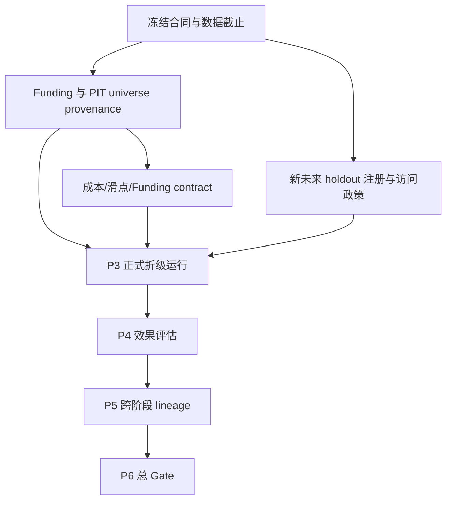

# 量化研究阻塞项实证盘点

生成时间：2026-10-25T06:01:52Z（UTC）。本轮只读调查，未训练、未正式 OOS、未读取 final holdout 数值、未发布 Git。

## 执行摘要

正式研究仍为 **BLOCKED**。前三个关键问题是：

1. **Funding 观测不等于支付事件（OBSERVED/BLOCKED）**。216 个本地文件可读，但三币 Funding 文件只有 `date/open/high/low/close/volume`，没有支付事件、结算规则版本或获取 provenance。现有代码已 fail-closed，不能把 1h 间隔当结算表。
2. **历史 universe 不是当前快照（OBSERVED/BLOCKED）**。`governance._historical_universe()` 拒绝历史可交易性声明；`exchangeInfo` 只证明采集时状态，不能证明历史上市、下架、暂停或合约状态。
3. **final holdout 独立性不可证明（OBSERVED/BLOCKED）**。开发切分器注册最后 15%（2025-10-17T04:00Z），既有诊断/模型比较记录覆盖历史尾部；`holdout_access.json` 标记 `historical_independence=BLOCKED`。改名不能恢复独立性。

成本和 P3–P6 lineage 是下游阻塞：成本合同明确 `trade_evaluation_status=BLOCKED`；开发 P3 可独立重放，但没有正式效果、成本和跨阶段 lineage 证据。

## 真实基线（OBSERVED）

- 仓库 `/home/wangke/project/FreqtradeStratege`，分支 `main`。
- HEAD 与 `origin/main` 均为 `6c3b515876b612e659668b41594e826f348ed74c`。
- 工作区有既有未提交验收实现和未跟踪证据；本轮未修改源码、配置、数据或历史报告。
- 当前源码集合指纹 `362336d70227df76dfe530033f34e965aaa579df6f55fdb02905191b73090186`，与历史 RR-001 `FINAL_GATE.json` 一致。
- 历史工程验收文件存在；其工程结论为 PASS，正式研究仍 BLOCKED。本轮未重跑四档测试。
- 环境为 Python 3.13.13、pandas 3.0.5、NumPy 2.5.2、scikit-learn 1.9.0、XGBoost 3.4.1、Freqtrade 2026.7、PyArrow 25.0.1、ccxt 4.5.75、pytest 9.1.1。

机器明细见 [data_coverage.json](data_coverage.json)、[lineage_inventory.json](lineage_inventory.json)、[blockers.json](blockers.json) 和 [commands.json](commands.json)。

## 资产与数据盘点

`data/futures` 实际盘点 216 个 Feather：72 个 4h futures、72 个 1h mark、72 个 1h funding_rate，覆盖 72 个 pair。全部成功读取，UTC、递增、无重复和无空时间戳。三币覆盖：BTC/ETH futures 为 2020-01-01 至 2026-10-15（14880 行），mark 至 2026-10-12（59443 行），funding 至 2026-10-12（7429 行）；BNB futures/funding 起点为 2020-02-10（分别 14638/7308 行），mark 起点为 2020-01-01（59443 行）。

这些结果只证明文件结构和本地覆盖，不能证明来源真实性、支付事件完整性、历史可交易性或正式可用性。逐文件 SHA-256 在 `data_scan.json`。

## 五项阻塞

### Funding（BLOCKED，OBSERVED）

`src/quant_strategy/research/governance.py` 的 `assess_funding_evidence()` 默认 BLOCKED；`src/quant_strategy/research/costs.py` 要求 `historical_schedule_verified=false`、无 synthetic fallback，并要求逐币权威支付事件与 mark 对齐；`market_data/contracts.py` 也声明 publication delay 未验证。缺口是事件语义、规则版本和 provenance。最小方案是新增不可变 payment-event 表（事件时间、费率、结算规则版本、来源 URL/响应哈希/采集时间），验证 event–mark–position join，缺失即拒绝正式准入。成功标准是每个正式时期有权威来源、规则版本、无未解释缺口，并能由独立脚本重算。

### Point-in-time universe（BLOCKED，OBSERVED）

`_historical_universe()` 与 `native_features.py` 均说明 StaticPairList/current snapshot 不是历史 universe。文件存在不表示全历史可交易。最小方案是版本化 `effective_from/effective_to` 状态表，按 candle 时间 as-of join，未知状态拒绝进入正式 universe。需要外部 dated listing/delist/suspend/contract-state 证据。

### 成本、滑点与 Funding 成本（BLOCKED，OBSERVED）

`costs.py` 将生产 fee 标为 backtest assumption，滑点 `basis_points=None` 且 BLOCKED，Funding 成本要求真实支付事件。本地没有历史盘口或成交校准，不能声称历史滑点。最小方案是保留手续费假设标签，补充外部账户费率和盘口/成交样本；证据不足时只做预注册敏感性分析，不作净收益正式结论。

### Final holdout（BLOCKED，OBSERVED/UNKNOWN）

`splits.py` 可重算边界和 guard；`docs/acceptance/controlled_p3_20261018T111700Z/execution/holdout_access.json` 记录未生成指标但历史独立性 BLOCKED。既有文档记录 terminal tail 曾用于诊断/比较，完整访问历史无法证明没有其他读取，因此是 `INDEPENDENCE_UNVERIFIED`。最小方案是冻结合同和数据截止，登记未来未访问窗口的身份元数据，建立 append-only 访问日志和一次性评估权限；不输出旧 holdout 数值。

### P3–P6 lineage（BLOCKED，OBSERVED）

开发 P3 目录具备 source/config/input/dataset/folds/prediction/model/访问日志和独立重放：3 折、9 个 native fold、13770 prediction rows，`holdout_metrics_generated=false`。这证明开发基础设施，不证明正式 P3–P6。`training_readiness_summary.md` 明确 P3–P6 均 BLOCKED，缺正式阶段契约、跨阶段 parent IDs、正式成本/效果/holdout receipt 和独立聚合。应复用 experiment store、receipt 和 source fingerprint，formal runner 增加 stage ID/父哈希并由独立 verifier 重算。

## 依赖关系与最小推进顺序

推荐先冻结 venue、合约、数据截止和证据等级；随后并行取得 Funding payment/rule provenance 与 point-in-time universe；证据范围冻结后登记新 holdout；再冻结成本合同，扩展 formal P3 lineage，最后才做 P4/P5/P6。首个可执行任务是“**三币 Funding/universe provenance 证据包设计与只读验证器**”：不读取 holdout、不训练、不改生产语义，可同时减少两个共同前置阻塞。

## 验证命令和成功标准

已执行命令与退出码见 `commands.json`。下一阶段应先执行 `python tools/audit_historical_coverage.py --help`、`python tools/audit_training_data.py --help`、`python tools/audit_native_features.py --help`，确认参数后运行只读审计，再用独立解析器交叉检查时间、哈希、事件和 as-of 状态。任何缺失 provenance、规则、历史状态、成本证据或 parent artifact 都必须非零退出并保持 BLOCKED；不能把报告自报 PASS 当独立证据。

## Git 与保护边界

本轮只读检查显示 8 个 tracked 修改、1090 个未跟踪路径；未执行 Git 写操作。对 `src/quant_strategy/execution`、`features`、`labels`、`portfolio` 及 `configs/base.yaml`、`configs/research.yaml` 的 `git diff` 为空。本轮未逐字节审查全部未跟踪工件，故不能宣称完整发布安全。

## 尚未验证与人工决策

Funding 权威历史 API/归档、72 币历史 universe 来源、新 holdout 未来窗口与一次性评估人、账户费率和盘口证据等级、P3/P6 正式定义均需人工决定或外部数据；跨机器复现历史为 UNVERIFIED。正式研究、候选模型优选、收益排名、生产模型更新和实盘继续锁定。
